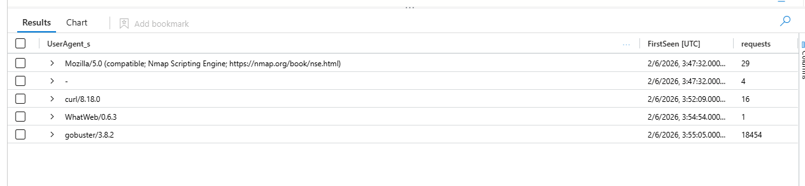

# Threat Hunt Report: Meridian

Participant: Donavin Mcknezie Date: September 2026

## Platforms and Languages:

Platforms:

- Azure Sentinel
- Log analytics Workspace
- Ubuntu (22.04)

Languages/Tools:

- KQL

## Scenario:

Meridian's portal threw a real incident overnight. Single host, web app in front of a patient database, and a defense stack that has been fighting back automatically the whole time. Some of what it caught is the real intrusion. Some of it is the stack tripping over its own bootstrap. Telling those apart is the job.

An external IP connected to the web server and moved through SQL injection, credential theft, SSH backdoors, and privilege escalation on a single Ubuntu host running Apache, PHP, and MySQL. A six-service automated defense suite was active throughout, logging detections and periodically reverting SSH keys, crontabs, and temp directories.

## Section 1: The Recon Playbook

The attacker used more than one tool to map this web server before touching anything sensitive. How many distinct recon tools hit the web server, and what were they? List them in the order they first appeared.

Solution:

Grouping the Apache access log by distinct User-Agent for the attacker IP (10.1.134.57) and ordering by first-seen time revealed four recon tools used in sequence before any exploitation. Nmap set its User-Agent to look like a Mozilla browser, but the string still contained "Nmap Scripting Engine," which identified it. A burst of empty ("-") User-Agents arrived at the same second as Nmap and was treated as part of that scan, not a separate tool.

nmap, curl, whatweb, gobuster

```jsx
MeridianAccess_CL
| where EventTime_t between (datetime(2026-02-06, 02:42) .. datetime(2026-02-06 05:30:00))
| where ClientIp_s == "10.1.134.57"
| summarize FirstSeen= min(EventTime_t), requests=count() by UserAgent_s
| order by FirstSeen asc
```



## Section 2a: The Traversal point

Before the mass wordlist scanning starts, the attacker deliberately touches one endpoint on its own, the one that turns out to be their way in. Name it.

solution: 
I pulled every request from the attacker IP, projected the URI, status, and User-Agent, and ordered by time to read the activity in sequence. The gobuster requests begin at 03:55:05 as a rapid run of 404s, so I focused on what came before that. In that earlier window `/config_viewer.php` stands out at 03:52:29, a specific application page rather than a generic path like `/` or `/robots.txt`. It returned a 302 redirect, and the same endpoint shows up again later with traversal payloads, which confirms it as the way in.

config_viewer.php

```jsx
MeridianAccess_CL
| where EventTime_t between (datetime(2026-02-06, 02:42) .. datetime(2026-02-06 05:30:00))
| where ClientIp_s == "10.1.134.57"
| project EventTime_t, RequestUri_s, StatusCode_s, UserAgent_s
| order by EventTime_t asc
```


## Section 2b: What they pulled

Once they're authenticated, that endpoint has a file parameter that isn't scoped to what it should be. They pull two files through it, in order. Name both, in the order they were read.

Solution:

I filtered the attacker's requests to the config_viewer endpoint and ordered by time. After the initial 302 at 03:52:29, two later requests use the `file=` parameter and both return 200: at 04:07:59 the parameter is a traversal string reaching `/etc/passwd`, and at 04:08:34 it points to the database config. The order they were read follows directly from the timestamps.

 ../../../etc/passwd, database.conf

```jsx
MeridianAccess_CL
| where EventTime_t between (datetime(2026-02-06, 02:42) .. datetime(2026-02-06 05:30:00))
| where ClientIp_s == "10.1.134.57"
| where RequestUri_s has "config" and UserAgent_s has "curl"
| project EventTime_t, RequestUri_s, StatusCode_s, UserAgent_s
| order by EventTime_t asc
```


## Section 3a: Borrowed Access

Under a minute after reading database.conf, they're in over SSH, as a real account, not a new one they created. Name it.

Solution:
I queried the auth log for SSH activity in the minutes right after the database.conf read (04:08), filtering on the sshd process and ordering by time. At 04:09:31 the log shows `Accepted password for svc_backup from 10.1.134.57`, with a matching session-opened line for the same user (uid 1001). That's a successful SSH login as an existing account, under a minute after the file read.

svc_backup

```jsx
MeridianAuth_CL
| where EventTime_t between (datetime(2026-02-06, 04:08) .. datetime(2026-02-06 04:10:00))
| where ProcessName_s contains "ssh"
| order by EventTime_t asc
```


## Section 3b: The Road not taken

Besides the SUID shell, the attacker tried two other ways to get root access on the compromised host. Name both methods and state why each one failed.

Solution:

I searched the defender log for any message mentioning root across the incident window. Two failed escalation methods show up alongside the attacker's svc_backup access. At 04:15:07 a sudo attempt by svc_backup is logged as `command not allowed`, meaning the account isn't permitted to run it. Separately, SSH login attempts as root from the attacker IP 10.1.134.57 are logged as failed (attempts 1 and 2). The root login attempts from 10.1.15.67 are the host's own address, not the attacker, so I left those out.

sudo as svc_backup, denied, direct root SSH login, failed, wrong root password

```jsx
MeridianDefender_CL
| where EventTime_t between (datetime(2026-02-06, 02:42) .. datetime(2026-02-06 05:30:00))
| where RawMessage_s contains "root"
| order by EventTime_t asc
```


## Section 4: The Planted Root Shell

svc_backup checks its own sudo rights first and gets nothing. Half an hour later they're root anyway, through a binary that was already sitting on disk waiting for them. Give me the full path and the flag it was run with.

Solution:

I searched the audit log for commands whose arguments referenced root and projected the identity fields. One row at 04:40:15 runs `/tmp/rootbash` with the `-p` flag. The `auid_s` is 1001 (svc_backup, the original login identity) while the `euid_s` is 0 (root), which shows the account reached root through this binary. The `-p` flag keeps those root privileges rather than dropping them.

/tmp/rootbash -p

```jsx
MeridianAudit_CL
| where EventTime_t between (datetime(2026-02-06, 02:42) .. datetime(2026-02-06 05:30:00))
| where Argv_s contains "root"
| order by EventTime_t asc
| project EventTime_t, comm_s, exe_s, Argv_s, auid_s, euid_s
```


## Section 5a: The second Foothold

The /tmp shell is loud and sits somewhere obviously wrong. They plant something better a few minutes later -- same trick, a much more convincing location. Give me the full path.

Solution:
I pulled the snapshot table for the incident window. The flagged process beacon points to `/opt/meridian/scripts/health_check`, and the `ProcBeaconExeLink_s` value shows that path is a symlink to `/exe` owned by root, captured at 04:51, minutes after the /tmp shell. The name and location look like a routine maintenance script, which is what makes it a more convincing hiding spot than /tmp.

/opt/meridian/scripts/health_check

```jsx
MeridianSnapshot_CL
| where isnotempty(EventTime_t)
| where EventTime_t between (datetime(2026-02-06 02:42) .. datetime(2026-02-06 05:30))
| where ProcBeaconExeLink_s has "scripts" or ProcBeaconExeLink_s has "root"
| project EventTime_t, ProcBeaconName_s, ProcBeaconExeLink_s, ProcBeaconUid_s
| order by EventTime_t asc
```


## Section 5b: Why it survived

The automated defence caught the /tmp shell in its next sweep and killed it. It caught this second one too -- flagged it as non-baseline, in the log, in plain sight. It's still running. Explain what category of thing the sweep actually cleans up automatically, and why this doesn't fall into any of them.

Solution:
Filtering the sweep events to baseline-related messages returns the `health_check` file flagged as `Non-baseline file in scripts/`. Comparing this against the sweep's other actions across the window shows what it actually removes: SUID binaries in /tmp, reverted SSH keys, reverted crontabs, cleaned temp directories, and restored baseline files it has a known-good copy of (like backup.conf). The second shell fits none of those: it's in /opt/meridian/scripts rather than /tmp, and it's a newly added file with no baseline version to restore from. So the sweep can detect it and log it, but it has no rule that acts on it, detection without removal.

sweep auto-cleans a fixed set

```jsx
MeridianDefender_CL
| where EventTime_t between (datetime(2026-02-06 02:42) .. datetime(2026-02-06 05:30))
| where EventCategory_s has "SWEEP" and RawMessage_s has "baseline"
| order by EventTime_t asc
```


## Section 6a: Calling home

The second backdoor doesn't sit idle -- it keeps trying to reach out. Give me the destination it kept hitting, and tell me whether that block alone actually neutralised it.

Solution:

I filtered the defender log to network events for the window. They're all the same line repeated: `Blocked exfil to 10.1.134.57:43212 from 10.1.15.67`. The backdoor keeps trying to reach that destination, and the defence stack blocks each attempt at the network level. A block stops the outbound traffic on that one path, but it doesn't kill the process or remove the file, the backdoor is still running and could try another route, so blocking alone doesn't neutralise it.

10.1.134.57:43212, not neutralized

```jsx
MeridianDefender_CL
| where EventTime_t between (datetime(2026-02-06 02:42) .. datetime(2026-02-06 05:30))
| where EventCategory_s has "Network"
| order by EventTime_t asc
```


## Section 6b: What the block proves

The network block stopped 73 outbound connections to the C2 destination. State what this evidence proves about the threat, and what it does not prove.

Solution:
The snapshot confirms the backdoor process (`health_check`, linked to /opt/meridian/scripts/health_check) is still present with a live PID. Combined with the 73 blocked outbound attempts, that shows the process is running and actively trying to beacon. What it doesn't show is any process kill or file removal, so the block only cut the traffic, not the backdoor itself.

proves the backdoor is still running and beaconing to C2 (network traffic blocked), does not prove it was neutralised, the process was never killed nor the binary removed.

```jsx
MeridianSnapshot_CL
| where isnotempty(EventTime_t)
| project EventTime_t, ProcBeaconExeLink_s, ProcBeaconPid_s
```


## Section 7a: What left the database

Somewhere in this window the defence stack flags a full export off the application's own data. Given the estate, what kind of data are we talking about?

Solution:
Filtering the defender log for export events returns one WEB entry at 03:56:28: `Patient data export from 10.1.134.57`. Since the host fronts a patient database, the exported data is patient records.

Patient data

```jsx
MeridianDefender_CL
| where EventTime_t between (datetime(2026-02-06 02:42) .. datetime(2026-02-06 05:30))
| where RawMessage_s has "export"
| order by EventTime_t asc
```


## Section 7b:

One more thing the final sweep catches and reverts, beyond its usual SSH-key/crontab routine -- a config file, tampered with. Name it.

Solution:

The automated sweep's normal routine is reverting SSH keys and crontabs, but this flag asks for a config file it caught being tampered with. I queried the defender log for sweep activity and filtered the messages to anything containing "tampered," then ordered by event time.

The query returned a single row at 05:05:02 UTC: `backup.conf tampered -- reverting`. This tells us two things. First, the attacker modified `backup.conf` at some point during the intrusion. Second, the sweep was able to revert it, which it can only do for files it holds a known-good baseline copy of. That's the same mechanism that let it restore other baseline files, and it's the reason this file was remediated while the planted `health_check` shell (a net-new file with no baseline) was only flagged and left in place.

backup.conf

```jsx
MeridianDefender_CL
| where EventTime_t between (datetime(2026-02-06 02:42) .. datetime(2026-02-06 05:30))
| where RawMessage_s has "tampered"
| order by EventTime_t asc
```


## Section 8a: Signal or Setup Noise

Before any of the real intrusion, the defence log already fires a burst of detections -- SSH key changes, crontab changes, a new systemd service, all auto-reverted within a second. Is that part of the intrusion, or something else? State which, and why.

Solution:

I pulled the DETECTION events and ordered by time. The earliest burst all hits at 02:53:31, SSH key changes, crontab changes, and new systemd service detections, each reverted within the same second. That's before the attacker shows up (recon starts around 03:47) and isn't tied to the attacker IP or svc_backup. It's the defense stack starting up and flagging its own setup, not the intrusion.

false positive, defense stack bootstrap / self-baselining (the stack detecting and reverting its own startup changes, before any attacker activity)

```jsx
MeridianDefender_CL
| where EventTime_t between (datetime(2026-02-06 02:42) .. datetime(2026-02-06 05:30))
| where EventCategory_s has "DETECTION"
| order by EventTime_t asc

```


## Section 8b: Collateral Damage

The very first automated sweep -- long before the real intrusion starts -- removes a 'new systemd service' as part of its routine cleanup. It took out something that wasn't the attacker's. Name what it killed, and what that cost the investigation for the rest of the incident.

Solution:
I filtered the sweep events to removals. At 03:08:20, before the intrusion, the sweep removed `sysmon.service`. Sysmon is a monitoring/logging service, so by killing its own telemetry source during bootstrap the stack blinded the investigation, any process, file, or network detail Sysmon would have recorded for the rest of the incident is gone.

sysmon.service

```jsx
MeridianDefender_CL
| where EventTime_t between (datetime(2026-02-06 02:42) .. datetime(2026-02-06 05:30))
| where EventCategory_s has "SWEEP"
| where RawMessage_s has "Removed"
| order by EventTime_t asc
```


## Section 9a: Capturing the Evidence

Once the returning admin is back on the box, they don't just look around -- they capture volatile state properly, twice. Name the tool and where the output landed.

Solution:

I pulled the audit log for full command executions after the SSH login. Alongside the rootbash row, avml runs twice, at 05:27:48 and 05:28:24, under auid 1000 (the returning admin, not the attacker's 1001). Both runs write to /tmp/evidence/memory.lime, which is a memory capture of the host's volatile state.

avml, /tmp/evidence/memory.lime

```jsx
MeridianAudit_CL
| where EventTime_t between (datetime(2026-02-06 04:09:00) .. datetime(2026-02-06 05:30:00))
| where Types_s =="CWD,EXECVE,PATH,PROCTITLE,SYSCALL"
| project EventTime_t, Types_s, comm_s, exe_s, Argv_s, auid_s, euid_s
| order by EventTime_t asc
```


## Section 9b: What's still live

Pull it together. The automated sweep ran its full cycle, the admin came back and did the responsible forensic thing, and this still isn't closed. What's the one concrete action IR still has to do manually before this incident can actually be called contained?

Solution:

The sweep ran its full cycle and the admin captured memory, but the final sweep line at 05:05:06 still only flags the second shell as `Non-baseline file in scripts/: health_check`. It was detected, never removed, and earlier evidence shows the process is still running and still beaconing. The sweep won't touch it because it's a new file outside its cleanup rules, so a person has to do it by hand.

 Kill the running second backdoor process and remove its binary

```jsx
MeridianDefender_CL
| where EventTime_t between (datetime(2026-02-06 04:09:00) .. datetime(2026-02-06 05:30:00))
| where RawMessage_s has "health_check"
| order by EventTime_t asc
```


